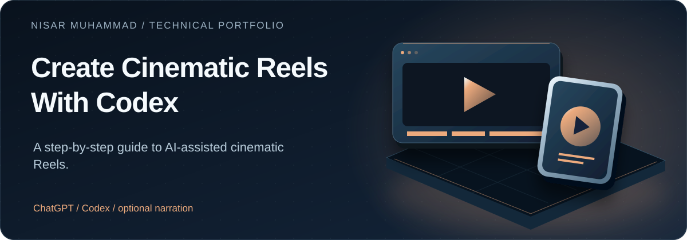

<picture>
  <source media="(max-width: 640px)" srcset="Assets/phase2/hero-mobile.svg" />
  
</picture>

# Create Cinematic Reels With Codex

Prepared by **Nisar Muhammad** · [Instagram @nisarmohammed](https://www.instagram.com/nisarmohammed/)

A beginner-friendly guide to planning and creating cinematic Instagram Reels using ChatGPT, OpenAI Codex and optional ElevenLabs narration. No prior coding experience is required to follow the guide. You must review commands, permissions, generated code and results.

**[Download the Beginner's Step-by-Step Guide (PDF)](https://github.com/nisarnis-prog/Create-Cinematic-Reels-With-Codex/releases/download/v1.0.0/Create-Cinematic-Reels-With-Codex.pdf)** · **[Copy the prompts](COPY-PASTE-PROMPTS.md)** · **[Start here](START-HERE.md)**

##  What you will learn

- Connect a local project to Codex and prepare a video workspace.
- Plan narration and scene visuals with ChatGPT.
- Give Codex a detailed production prompt and review a short sample.
- Add your own recorded voice or optional ElevenLabs narration.
- Request corrections and export a vertical MP4.

##  Required tools and prerequisites

Use a Windows or Mac computer, internet access, sufficient free storage, access to a supported Codex interface and a video idea. A phone helps you review the result. Codex should check for Node.js, npm, FFmpeg, FFprobe and a Remotion/Chromium rendering setup, reuse working tools and explain missing requirements before changes.

##  Seven-step workflow

1. **Install Codex.** Follow official installation and sign-in instructions.
2. **Create and connect the project.** Create AI_Video_Editor in Documents and open it as the active Codex project.
3. **Prepare the workspace.** Use Prompt 1 and verify that the short test MP4 plays before continuing.
4. **Plan using ChatGPT.** Use Prompt 2 to approve narration and visuals and prepare a detailed Codex brief.
5. **Submit the production prompt.** Paste the brief and Prompt 3 into Codex and review the 10–15-second sample.
6. **Add narration.** Use your own recording or optionally use Prompt 4 for ElevenLabs after approving the script and costs.
7. **Review, correct and export.** Use Prompt 5 after approval, request timestamp-based corrections with Prompt 6 and verify the MP4 in the Output folder.

##  Optional ElevenLabs narration

ElevenLabs is a separate, optional service and may require credits or a paid subscription. Choose an authorized voice and approve the script, settings and credit usage before generation. Reuse working integrations and cache successful takes. Configure keys securely and identify the exact failing endpoint when troubleshooting. Optional model-listing and account-reading permissions may differ from Text to Speech permissions.

## Important limitations

One prompt does not guarantee cinematic quality. Codex availability, usage limits, rendering performance, completion time and output quality depend on your account, computer, installed tools and project complexity. Interfaces may change. Custom video-production skills are available only when installed and accessible in your Codex environment. This guide has not been independently tested across every supported operating system or Codex configuration.

## Safety Precautions

- Review every command and permission request before approval.
- Use official software download sources and approve only necessary system changes.
- Back up project files before changes.
- Protect passwords, API keys and private information. Never commit credentials or environment files to GitHub.
- Review third-party costs, usage limits and license terms.
- Use only authorized voices, music, images and video assets.
- Render a short test sample before a full video and verify exports before publishing.

## User Responsibilities

You are responsible for authorization, evaluating generated code and commands, choosing appropriate permissions, maintaining backups, protecting credentials, checking costs and results, and following copyright law and platform policies. Obtain permission for voices, likenesses and protected materials.

## Disclaimer and Limitation of Liability

This is an independent educational publication by Nisar Muhammad. It is not an official OpenAI, ElevenLabs, Remotion or FFmpeg publication and implies no endorsement. Materials are provided as is, without warranties, subject to the license and applicable law. To the extent permitted by law, the author disclaims liability for loss, damage, disruption, security incidents, costs or other consequences of use. Users must evaluate suitability and verify results. This notice does not override rights or obligations that cannot lawfully be excluded.

## License

Copyright © 2026 Nisar Muhammad. Original guide content, documentation, prompts and original illustrations use **Creative Commons Attribution 4.0 International (CC BY 4.0)**. Attribute Nisar Muhammad, link to the license and indicate changes. See [LICENSE](LICENSE) for the complete official text and scope.

This license excludes OpenAI, ElevenLabs, Remotion, FFmpeg and other third-party software, services, trademarks and materials. Their own terms apply.

## Official resources

- [Codex documentation and getting started](https://developers.openai.com/codex/)
- [ChatGPT](https://chatgpt.com/)
- [Remotion documentation](https://www.remotion.dev/docs/)
- [FFmpeg](https://ffmpeg.org/)
- [ElevenLabs documentation](https://elevenlabs.io/docs/)
- [CC BY 4.0](https://creativecommons.org/licenses/by/4.0/)

## Author

Prepared by **Nisar Muhammad**.

[GitHub nisarnis-prog](https://github.com/nisarnis-prog) · [Instagram @nisarmohammed](https://www.instagram.com/nisarmohammed/)
